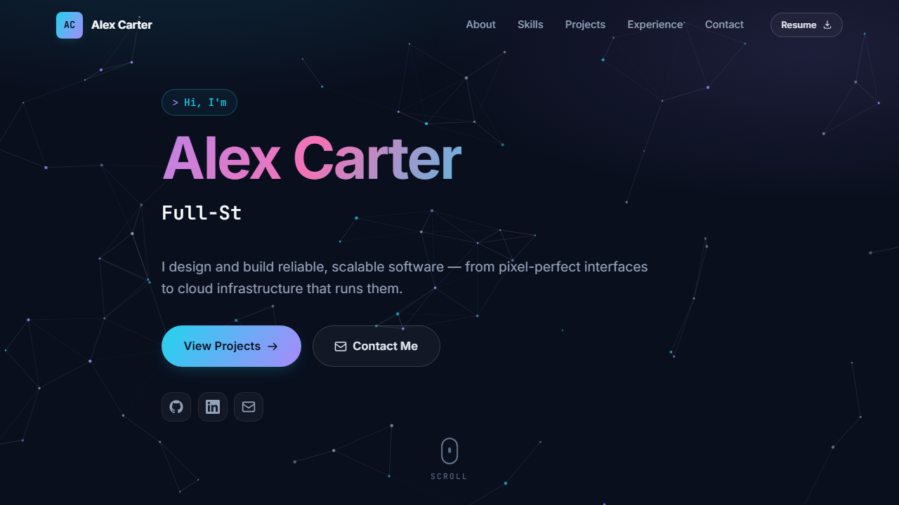

# Portfolio

Single-page IT portfolio built with React 19 and Vite.

## Demo

[](docs/portfolio-demo.webm)

▶ [Watch the walkthrough video](docs/portfolio-demo.webm) — a scroll through
the hero, about, skills, projects, experience and contact sections.

## Scripts

```bash
npm install      # install dependencies
npm run dev      # start dev server
npm run build    # production build to dist/
npm run preview  # preview the production build
npm run lint     # run oxlint
```

## Customising

All content (name, roles, bio, skills, projects, experience, links) lives in
`src/data/portfolio.js`. Colours, fonts and spacing tokens are in
`src/styles/variables.css`.

## Deploying

Run `npm run build` and deploy the `dist/` folder to any static host
(Vercel, Netlify, GitHub Pages, Cloudflare Pages, etc.).
